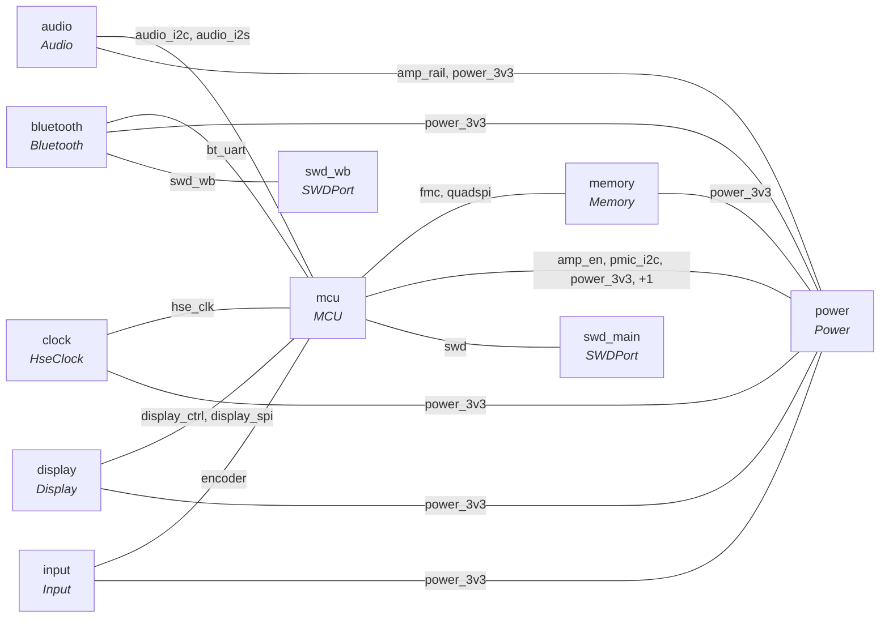
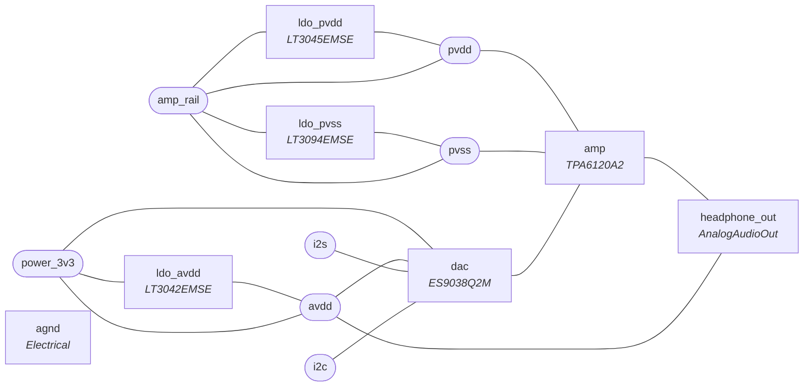
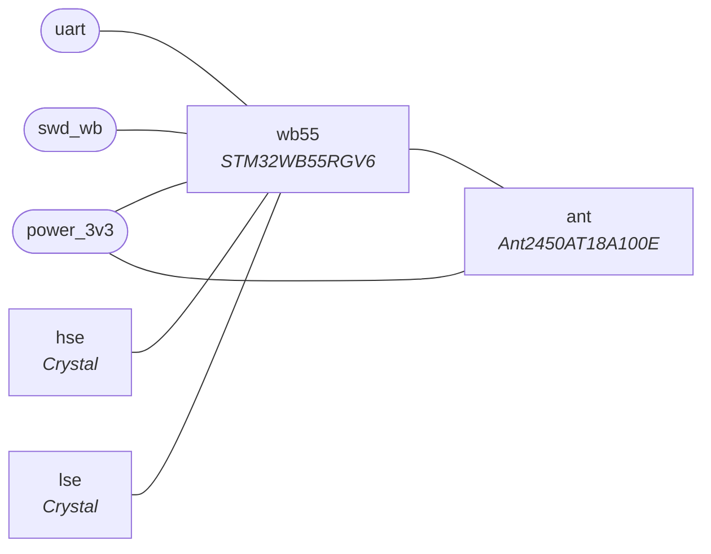
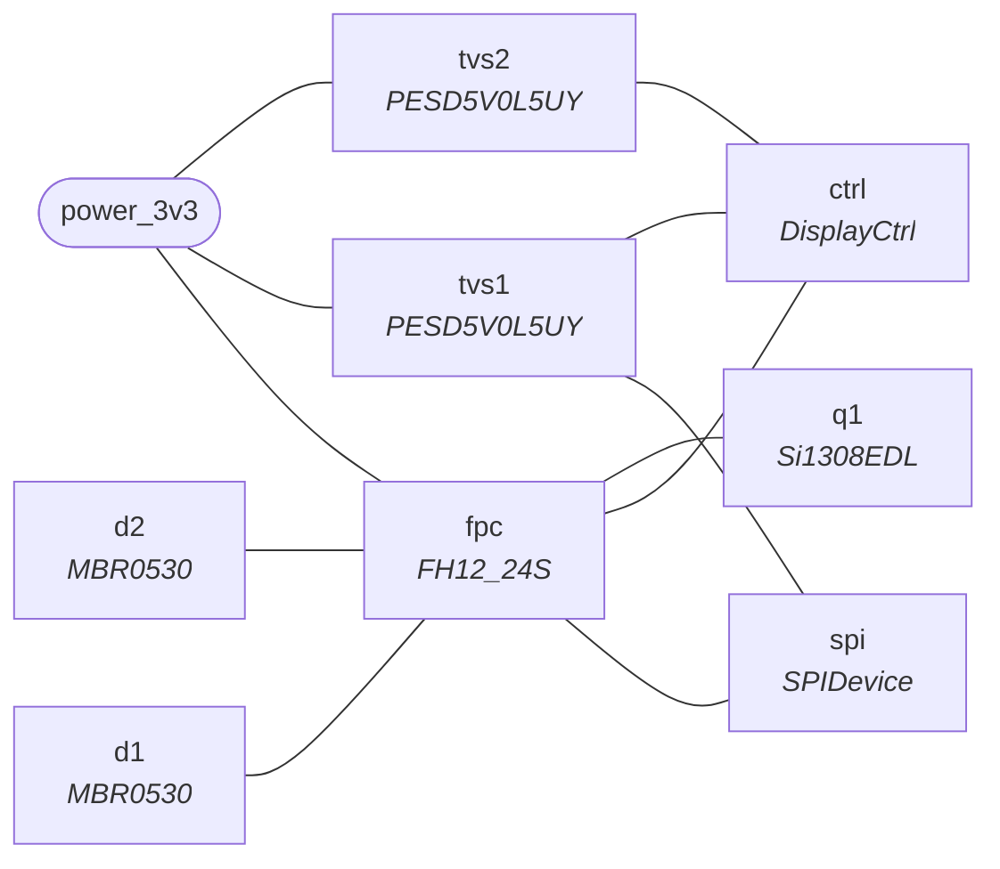
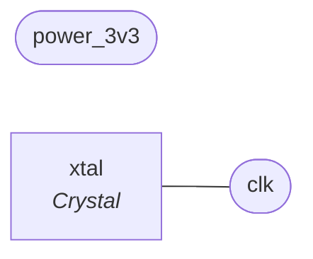
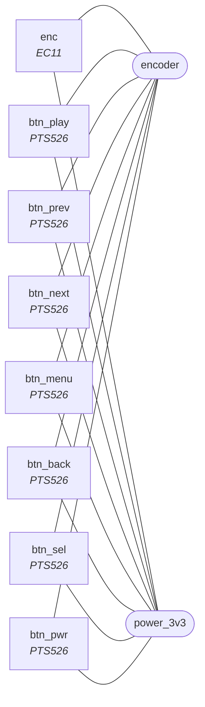
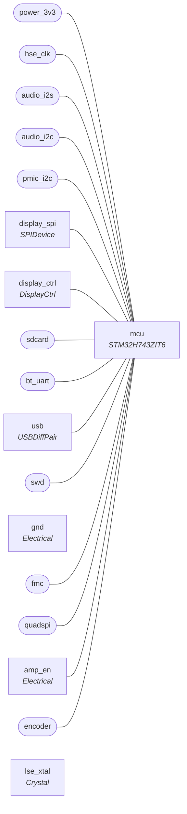
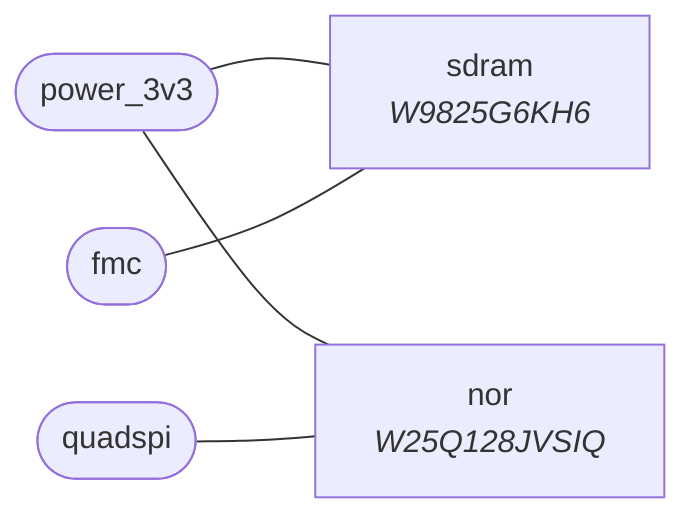
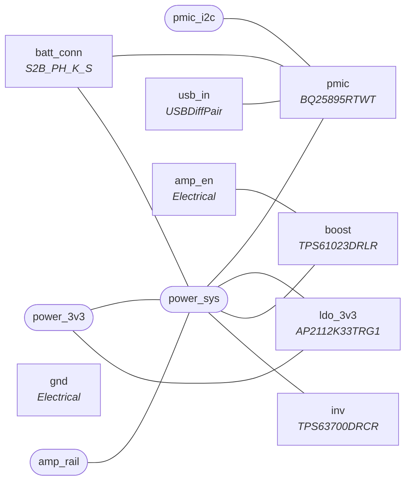

# Circuit — SoulAudio DAP
**Generated** from `hardware/elec/src/**/*.ato` by `tools/ato-diagram.py`. Do not edit.
This is a reading of the SOURCES, not a netlist. It shows connections as written, knows nothing about footprints, designators or placement, and draws one edge for an interface-to-interface connection that carries many signals. For the authoritative pinout, power tree and 3D model, sign in (`ato auth login`) and run `ato build -b default` — see `docs/hardware/ATOPILE-TOOLCHAIN.md` for why that needs a person.

## Board

`SoulAudioDAP` instantiates 10 modules with 22 connection statements between them.

## Modules

### `Audio`
hardware/elec/src/audio.ato
14 part(s), 26 passive(s), 14 assert(s)

26 passives (collapsed)

- `c_amp_l_neg` — Capacitor
- `c_amp_l_pos` — Capacitor
- `c_amp_r_neg` — Capacitor
- `c_amp_r_pos` — Capacitor
- `c_avdd_bulk` — Capacitor
- `c_avdd_hf` — Capacitor
- `c_byp` — Capacitor = 10uF +/- 20%
- `c_dac_1` — Capacitor
- `c_dac_2` — Capacitor
- `c_pvdd_bulk` — Capacitor
- `c_pvdd_hf` — Capacitor
- `c_pvss_bulk` — Capacitor
- `c_pvss_hf` — Capacitor
- `r_fb_l` — Resistor = 1.5kohm +/- 1%
- `r_fb_r` — Resistor = 1.5kohm +/- 1%
- `r_ilim` — Resistor = 100kohm +/- 5%
- `r_iref` — Resistor = 1.21kohm +/- 1%
- `r_mute` — Resistor = 10kohm +/- 5%
- `r_pg` — Resistor = 100kohm +/- 5%
- `r_pvdd_ilim` — Resistor = 2.0kohm +/- 5%
- `r_pvdd_pg` — Resistor = 100kohm +/- 5%
- `r_pvdd_set` — Resistor = 49.9kohm +/- 1%
- `r_pvss_ilim` — Resistor = 2.0kohm +/- 5%
- `r_pvss_pg` — Resistor = 100kohm +/- 5%
- `r_pvss_set` — Resistor = 49.9kohm +/- 1%
- `r_set` — Resistor = 33kohm +/- 1%

design rules (asserts)

- `avdd.voltage within 3.2V to 3.4V  # LT3042 output tolerance`
- `r_set.resistance within 32kohm to 34kohm`
- `r_ilim.resistance within 90kohm to 110kohm`
- `c_byp.capacitance within 8uF to 12uF`
- `power_3v3.voltage within 3.0V to 3.6V`
- `avdd.voltage within 3.2V to 3.4V`
- `r_mute.resistance within 8kohm to 12kohm`
- `r_iref.resistance within 1.19kohm to 1.23kohm`
- `r_pvdd_set.resistance within 49.4kohm to 50.4kohm`
- `r_pvss_set.resistance within 49.4kohm to 50.4kohm`
- `r_fb_l.resistance within 1.35kohm to 1.65kohm`
- `r_fb_r.resistance within 1.35kohm to 1.65kohm`
- `pvdd.voltage within 4.8V to 5.2V`
- `pvss.voltage within 4.8V to 5.2V`

> These are NOT checked by the offline build — they are solver constraints evaluated after part picking.

### `Bluetooth`
hardware/elec/src/bluetooth.ato
7 part(s), 9 passive(s), 4 assert(s)

9 passives (collapsed)

- `c_hse_1` — Capacitor
- `c_hse_2` — Capacitor
- `c_lse_1` — Capacitor
- `c_lse_2` — Capacitor
- `c_vdd_1` — Capacitor
- `c_vdd_2` — Capacitor
- `c_vdd_3` — Capacitor
- `c_vdd_4` — Capacitor
- `c_vdd_bulk` — Capacitor

design rules (asserts)

- `power_3v3.voltage within 1.7V to 3.6V  # WB55 supply range`
- `hse.frequency within 31MHz to 33MHz`
- `lse.frequency within 32kHz to 33768Hz`
- `c_vdd_bulk.capacitance within 8uF to 12uF`

> These are NOT checked by the offline build — they are solver constraints evaluated after part picking.

### `Display`
hardware/elec/src/display.ato
9 part(s), 17 passive(s), 1 assert(s)

17 passives (collapsed)

- `c_boost_in` — Capacitor = 4.7uF +/- 20%
- `c_rst` — Capacitor
- `c_vci_bulk` — Capacitor
- `c_vci_hf` — Capacitor
- `c_vcom` — Capacitor
- `c_vdd` — Capacitor
- `c_vddio` — Capacitor
- `c_vgh` — Capacitor
- `c_vgl` — Capacitor
- `c_vsh1` — Capacitor
- `c_vsh2` — Capacitor
- `c_vsl` — Capacitor
- `l1` — Inductor = 47uH +/- 20%
- `r_bias` — Resistor = 1Mohm +/- 5%
- `r_bs1` — Resistor
- `r_busy` — Resistor = 10kohm +/- 5%
- `r_sense` — Resistor = 2.2ohm +/- 5%

design rules (asserts)

- `power_3v3.voltage within 2.7V to 3.6V`

> These are NOT checked by the offline build — they are solver constraints evaluated after part picking.

### `HseClock`
hardware/elec/src/clock.ato
3 part(s), 2 passive(s), 3 assert(s)

2 passives (collapsed)

- `c_osc_in` — Capacitor = 18pF +/- 5%
- `c_osc_out` — Capacitor = 18pF +/- 5%

design rules (asserts)

- `xtal.frequency within 24MHz to 26MHz`
- `c_osc_in.capacitance  within 15pF to 22pF`
- `c_osc_out.capacitance within 15pF to 22pF`

> These are NOT checked by the offline build — they are solver constraints evaluated after part picking.

### `Input`
hardware/elec/src/input.ato
10 part(s), 20 passive(s), 20 assert(s)

20 passives (collapsed)

- `c_back` — Capacitor
- `c_enc_a` — Capacitor
- `c_enc_b` — Capacitor
- `c_enc_sw` — Capacitor
- `c_menu` — Capacitor
- `c_next` — Capacitor
- `c_play` — Capacitor
- `c_prev` — Capacitor
- `c_pwr` — Capacitor
- `c_sel` — Capacitor
- `r_back` — Resistor
- `r_enc_a` — Resistor
- `r_enc_b` — Resistor
- `r_enc_sw` — Resistor
- `r_menu` — Resistor
- `r_next` — Resistor
- `r_play` — Resistor
- `r_prev` — Resistor
- `r_pwr` — Resistor
- `r_sel` — Resistor

design rules (asserts)

- `power_3v3.voltage within 2.7V to 3.6V`
- `r_enc_a.resistance within 9kohm to 11kohm`
- `r_enc_b.resistance within 9kohm to 11kohm`
- `r_enc_sw.resistance within 9kohm to 11kohm`
- `r_play.resistance within 9kohm to 11kohm`
- `r_prev.resistance within 9kohm to 11kohm`
- `r_next.resistance within 9kohm to 11kohm`
- `r_menu.resistance within 9kohm to 11kohm`
- `r_back.resistance within 9kohm to 11kohm`
- `r_sel.resistance  within 9kohm to 11kohm`
- `r_pwr.resistance  within 9kohm to 11kohm`
- `c_enc_a.capacitance within 80nF to 120nF`
- `c_enc_b.capacitance within 80nF to 120nF`
- `c_enc_sw.capacitance within 80nF to 120nF`
- `c_play.capacitance within 80nF to 120nF`
- `c_prev.capacitance within 80nF to 120nF`
- `c_next.capacitance within 80nF to 120nF`
- `c_menu.capacitance within 80nF to 120nF`
- `c_back.capacitance within 80nF to 120nF`
- `c_sel.capacitance  within 80nF to 120nF`

> These are NOT checked by the offline build — they are solver constraints evaluated after part picking.

### `MCU`
hardware/elec/src/mcu.ato
18 part(s), 19 passive(s), 2 assert(s)

19 passives (collapsed)

- `c_lse_1` — Capacitor
- `c_lse_2` — Capacitor
- `c_vcap1` — Capacitor
- `c_vcap2` — Capacitor
- `c_vdd_1` — Capacitor
- `c_vdd_10` — Capacitor
- `c_vdd_11` — Capacitor
- `c_vdd_2` — Capacitor
- `c_vdd_3` — Capacitor
- `c_vdd_4` — Capacitor
- `c_vdd_5` — Capacitor
- `c_vdd_6` — Capacitor
- `c_vdd_7` — Capacitor
- `c_vdd_8` — Capacitor
- `c_vdd_9` — Capacitor
- `c_vdd_bulk` — Capacitor = 10uF +/- 20%
- `c_vdd_usb` — Capacitor
- `c_vdda_1` — Capacitor
- `c_vdda_2` — Capacitor

design rules (asserts)

- `power_3v3.voltage within 3.0V to 3.6V`
- `lse_xtal.frequency within 32kHz to 33768Hz     # 32.768 kHz LSE — RTC`

> These are NOT checked by the offline build — they are solver constraints evaluated after part picking.

### `Memory`
hardware/elec/src/memory.ato
5 part(s), 9 passive(s), 6 assert(s)

9 passives (collapsed)

- `c_nor_bulk` — Capacitor
- `c_nor_hf` — Capacitor
- `c_sdram_1` — Capacitor
- `c_sdram_2` — Capacitor
- `c_sdram_bulk` — Capacitor
- `r_io0` — Resistor
- `r_io1` — Resistor
- `r_io2` — Resistor
- `r_io3` — Resistor

design rules (asserts)

- `power_3v3.voltage within 2.7V to 3.6V`
- `r_io0.resistance within 30ohm to 36ohm`
- `r_io1.resistance within 30ohm to 36ohm`
- `r_io2.resistance within 30ohm to 36ohm`
- `r_io3.resistance within 30ohm to 36ohm`
- `c_nor_bulk.capacitance within 8uF to 12uF`

> These are NOT checked by the offline build — they are solver constraints evaluated after part picking.

### `Power`
hardware/elec/src/power.ato
12 part(s), 33 passive(s), 15 assert(s)

33 passives (collapsed)

- `c_3v3_bulk` — Capacitor
- `c_3v3_hf` — Capacitor
- `c_boost_in` — Capacitor = 10uF +/- 20%
- `c_boost_o1` — Capacitor
- `c_boost_o2` — Capacitor
- `c_btst` — Capacitor
- `c_inv_bias` — Capacitor = 100nF +/- 20%
- `c_inv_comp` — Capacitor = 4.7nF +/- 20%
- `c_inv_o1` — Capacitor
- `c_inv_o2` — Capacitor
- `c_inv_seq` — Capacitor = 100nF +/- 20%
- `c_pi_neg_in` — Capacitor = 10uF +/- 20%
- `c_pi_neg_out` — Capacitor = 10uF +/- 20%
- `c_pi_pos_in` — Capacitor = 10uF +/- 20%
- `c_pi_pos_out` — Capacitor = 10uF +/- 20%
- `c_pmid` — Capacitor
- `c_regn` — Capacitor
- `c_sys_bulk` — Capacitor
- `c_sys_hf` — Capacitor
- `fb_neg` — Resistor = 1ohm +/- 99%
- `fb_pos` — Resistor = 1ohm +/- 99%
- `l_boost` — Inductor = 1.5uH +/- 20%
- `l_inv` — Inductor = 1.0uH +/- 20%
- `l_sw` — Inductor = 4.7uH +/- 20%
- `r_boost_bot` — Resistor = 100kohm +/- 1%
- `r_boost_top` — Resistor = 357kohm +/- 1%
- `r_ilim` — Resistor = 100ohm +/- 5%
- `r_inv_bias` — Resistor = 10ohm +/- 5%
- `r_inv_bot` — Resistor = 100kohm +/- 1%
- `r_inv_seq` — Resistor = 100kohm +/- 5%
- `r_inv_top` — Resistor = 470kohm +/- 1%
- `r_stat` — Resistor
- `r_ts` — Resistor = 5.1kohm +/- 5%

design rules (asserts)

- `power_3v3.voltage within 3.2V to 3.4V`
- `power_sys.voltage within 3.0V to 4.35V  # LiPo operating range`
- `r_ilim.resistance within 90ohm to 110ohm`
- `c_btst.capacitance within 50nF to 150nF`
- `c_sys_bulk.capacitance within 15uF to 30uF`
- `l_sw.inductance within 3.5uH to 6uH`
- `r_boost_top.resistance within 350kohm to 364kohm`
- `r_boost_bot.resistance within 99kohm to 101kohm`
- `l_boost.inductance within 1.2uH to 1.8uH`
- `r_inv_top.resistance within 465kohm to 475kohm`
- `r_inv_bot.resistance within 99kohm to 101kohm`
- `l_inv.inductance within 0.8uH to 1.2uH`
- `c_inv_comp.capacitance within 3.5nF to 6nF`
- `r_inv_seq.resistance within 90kohm to 110kohm`
- `c_inv_seq.capacitance within 80nF to 120nF`

> These are NOT checked by the offline build — they are solver constraints evaluated after part picking.
